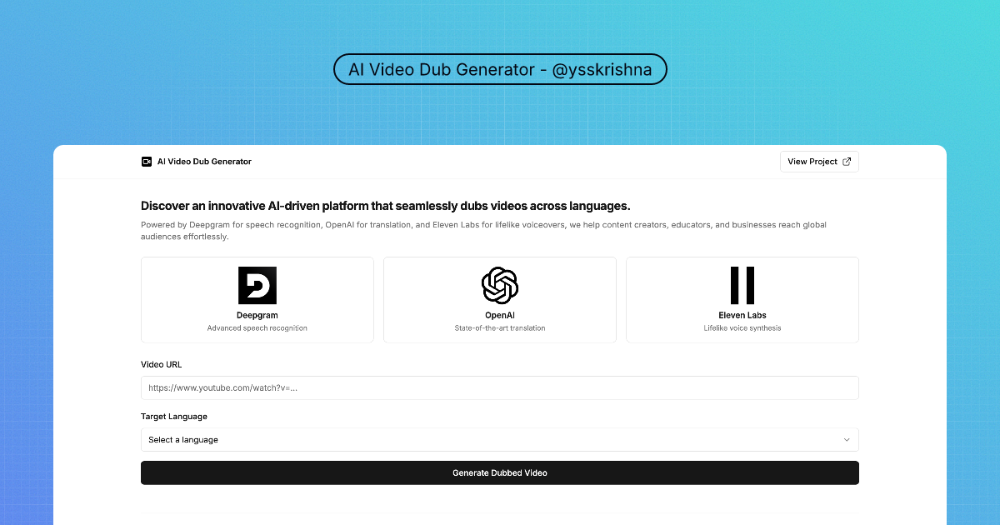
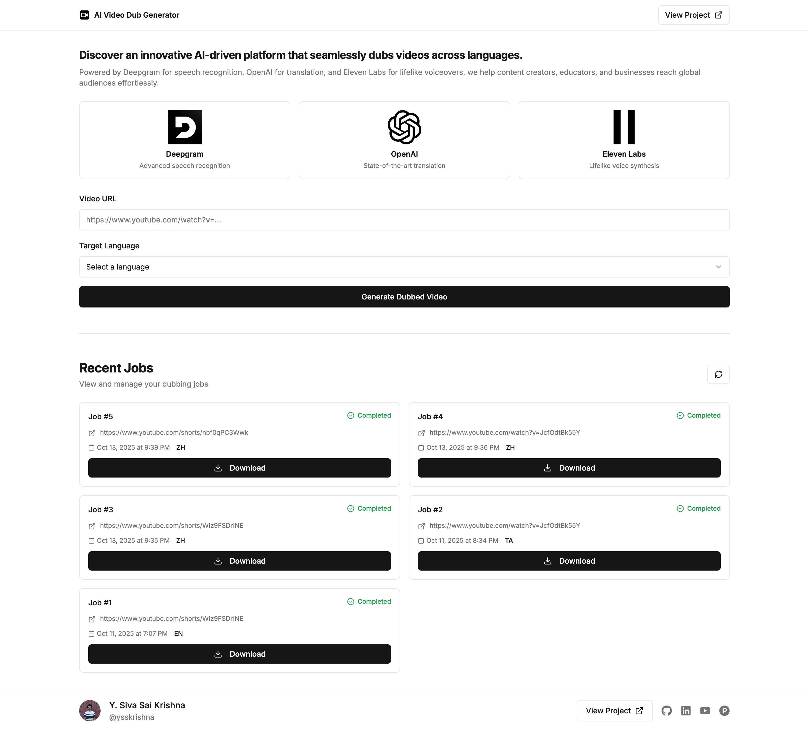
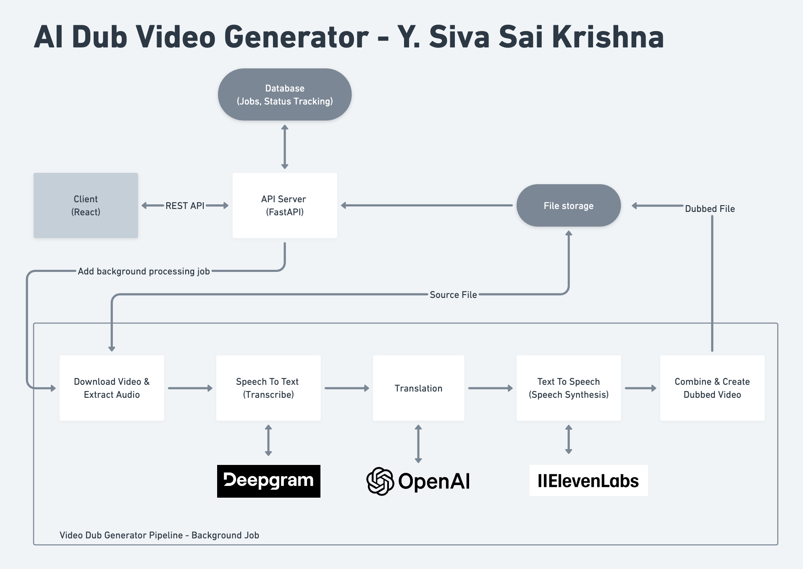

# AI Video Dub Generator

An innovative AI-driven platform that seamlessly dubs videos across languages. Powered by Deepgram for speech recognition, OpenAI for translation, and ElevenLabs for lifelike voiceovers, this application helps content creators, educators, and businesses reach global audiences effortlessly.

## Badges

[](https://github.com/ysskrishna/ai-video-dub-generator/blob/main/LICENSE)


[](https://ysskrishna.space)




## Demo


## Architecture Diagram


## ✨ Features

- **Automatic Video Dubbing**: Convert YouTube videos from one language to another with AI-powered translation and voice synthesis
- **Real-time Job Monitoring**: Track video dubbing progress with live status updates
- **Multiple Language Support**: Support for 30+ target languages
- **High-Quality Audio**: Advanced TTS engines for natural-sounding voice synthesis
- **Modern Web Interface**: Clean, responsive UI built with React and TypeScript
- **RESTful API**: FastAPI-based backend with automatic documentation

## 🚀 Quick Start

### Prerequisites

- **Node.js** v18+ (for frontend)
- **Python** 3.11+ with [UV](https://github.com/astral-sh/uv) (for backend)
- **API Keys**: Deepgram, OpenAI, and ElevenLabs

### Getting Started

1. **Clone the repository**
   ```bash
   git clone https://github.com/ysskrishna/ai-video-dub-generator.git
   cd ai-video-dub-generator
   ```

2. **Set up the Backend**
   - Navigate to `backend/` directory
   - Follow the detailed setup instructions in [backend/README.md](backend/README.md)
   - The API server runs on `http://localhost:8085`

3. **Set up the Frontend**
   - Navigate to `client/` directory
   - Follow the detailed setup instructions in [client/README.md](client/README.md)
   - The frontend runs on `http://localhost:8080`

## 📚 Documentation

- [Backend README](backend/README.md) - Backend setup, API documentation, and architecture details
- [Frontend README](client/README.md) - Frontend setup, project structure, and development guide


### Technology Stack

- **Frontend**: React, TypeScript, Vite, Tailwind CSS, shadcn/ui
- **Backend**: FastAPI (Python), SQLite, SQLAlchemy
- **AI Services**: 
  - [Deepgram](https://deepgram.com) - Speech-to-text transcription
  - [OpenAI](https://openai.com) - Language translation
  - [ElevenLabs](https://elevenlabs.io) - Text-to-speech synthesis
- **Video Processing**: MoviePy, yt-dlp

## 📺 Example Output

Check out example dubbed videos in the `media/examples/` directory:

### Example 1: English to Hindi
- **Source Video**: [YouTube Video](https://www.youtube.com/watch?v=JcfOdtBk55Y)
- **Dubbed Output**: [youtubeid_JcfOdtBk55Y_en_to_hi_dub.mp4](media/examples/youtubeid_JcfOdtBk55Y_en_to_hi_dub.mp4)

### Example 2: English to Chinese
- **Source Video**: [YouTube Video](https://www.youtube.com/watch?v=nbf0qPC3Wwk)
- **Dubbed Output**: [youtubeid_nbf0qPC3Wwk_en_to_zh_dub.mp4](media/examples/youtubeid_nbf0qPC3Wwk_en_to_zh_dub.mp4)

## Built and maintained by

AI Video Dub Generator is built and maintained by:

| | Name | GitHub | Role |
|---|------|--------|------|
|  | **Y. Siva Sai Krishna** | [@ysskrishna](https://github.com/ysskrishna) | Creator |

## Support

If you find this project helpful:

- ⭐ Star the repository
- 🐛 [Report issues](https://github.com/ysskrishna/ai-video-dub-generator/issues)
- 🔀 Submit pull requests
- 💝 [Sponsor on GitHub](https://github.com/sponsors/ysskrishna)

## License

MIT © [Y. Siva Sai Krishna](https://github.com/ysskrishna) — see [LICENSE](LICENSE) for details.

---

<p align="left">
  <a href="https://github.com/ysskrishna">Author's GitHub</a> •
  <a href="https://linkedin.com/in/ysskrishna">Author's LinkedIn</a> •
  <a href="https://ysskrishna.space">Author's site</a> •
  <a href="https://github.com/ysskrishna/ai-video-dub-generator/issues">Report Issues</a>
</p>
